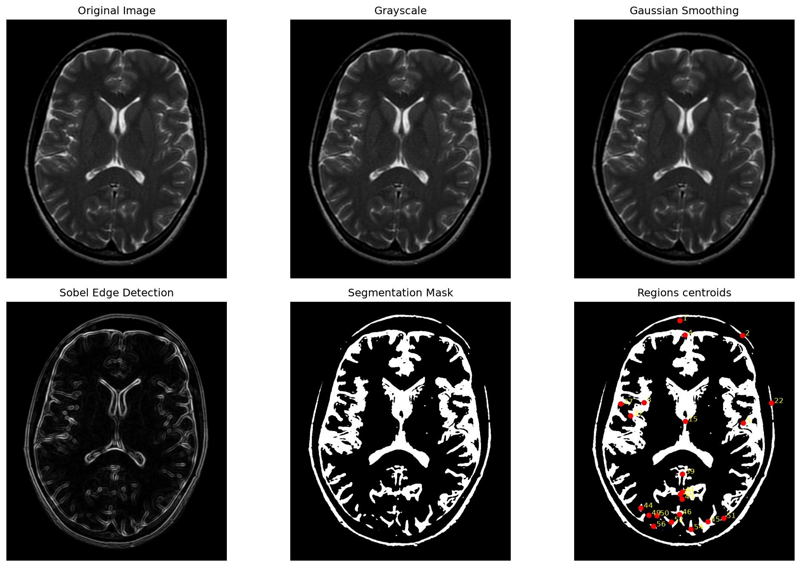

# Biomedical Image Processing & Region Analysis

## Overview

This proect is a python-based image processing pipeline developed to explore fundamental biomedical imaging techniques.

The program processes an rgb or rgba image, applies enhancement & segmentation tecnhiques, and analyzes connected regions based on their pixel area & centroid coordinates.

## Features


- RBG to grayscale conversion
- Gassian smoothing for noise redction
- Sobel Edge Detection
- Intensity-based image segmentation
- Connected components labeling
- region filtering based on minmum pixel area
- Centroid calculation
- Visualization & export of analysis results


## Technologies Used 

- Python 
- Numpy
- Scipy
- Matplotlib

## Example Results




## How to Run

1. Install Python and the required libraries.
2. Place an RGB or RGBA image named `sample.png` in the same folder as the Python script.
3. Run the Python script.
4. View the six-panel visualization.
5. Find the saved output in the `results` folder.

Install the required libraries using:

```bash
pip install numpy scipy matplotlib
```


## Parameters

The processing pipeline uses three adjustable parameters:

- `sigma = 2`: Controls Gaussian smoothing.
- `threshold = 0.5`: Determines which pixels are selected during segmentation.
- `min_area = 100`: Sets the minimum connected region area in pixels.


## Limitations

This project is intended for educational image analysis and is not a clinically validated diagnostic tool.

Segmentation is based on pixel intensity, and region areas are measured in pixels rather than physical units.
